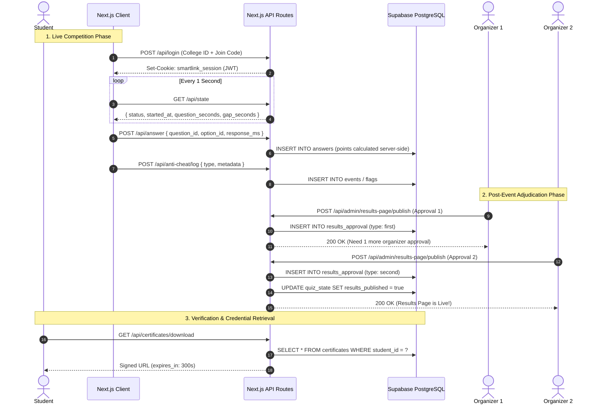
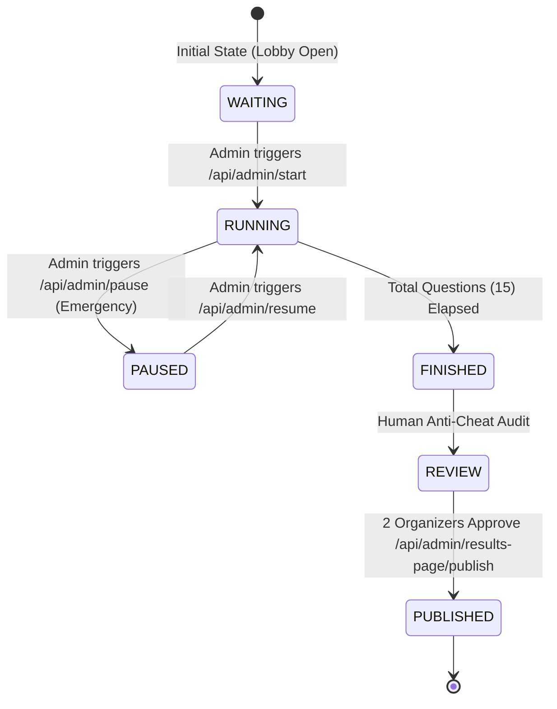

# System Architecture & Technical Specifications

This document details the architectural design, security boundaries, and communication topologies of the **SmartLink Git Quiz** platform.

---

## 1. System Topology & Data Flow

---

## 2. Competitive State Machine

---

## 3. Threat Model & Mitigations

### 3.1 Timing & Clock Tampering
- **Threat:** Student manipulates their local system clock backwards to gain extra seconds on questions.
- **Mitigation:** The client computes monotonic clock drift during every `/api/state` poll (`server_time - local_time`). All answer evaluation relies on server-authoritative timestamps, rejecting submissions received outside the permitted server epoch.

### 3.2 Inspect Element & Network Interception
- **Threat:** Student inspects browser DOM or network responses to identify correct answers ahead of time.
- **Mitigation:** The active question endpoint (`/api/question/[n]`) strictly returns `{ id, text, label }` options. The `is_correct` boolean and question explanations **never leave the server** until after the entire round has finished.

### 3.3 Multiple Logins & Credential Sharing
- **Threat:** One student shares their join code with another student outside the exam room.
- **Mitigation:** Layer 1 enforces one active session per student ID. When a login request succeeds, the token ID (`jti`) is pinned; concurrent requests from conflicting device fingerprints generate immediate `duplicate_session` warning flags.

### 3.4 PII & Data Leakage in Research
- **Threat:** Analyzing quiz telemetry risks deanonymizing students based on response speeds or names.
- **Mitigation:** `layer5-analysis/scripts/anonymize.py` replaces all UUIDs with random indices, drops names, emails, and device info, and rounds response times into 500ms bins before running IRT or ML models.

---

## 4. Database Schema & RLS Configuration

The database operates under **Row Level Security (RLS) with zero public policies**. All operational reads and writes are routed strictly through service-role API routes:

- `students`: `(id UUID PK, college_id TEXT UNIQUE, name TEXT, join_code TEXT UNIQUE, is_active BOOL)`
- `questions`: `(id UUID PK, text TEXT, difficulty TEXT, topic TEXT, explanation TEXT, points_base INT)`
- `options`: `(id UUID PK, question_id UUID FK, text TEXT, label TEXT, is_correct BOOL)`
- `answers`: `(id UUID PK, student_id UUID FK, question_id UUID FK, position INT, response_ms INT, points INT)`
- `events`: `(id UUID PK, student_id UUID FK, type TEXT, metadata JSONB)`
- `flags`: `(id UUID PK, student_id UUID FK, flag_type TEXT, severity TEXT, details JSONB)`
- `reviews`: `(id UUID PK, student_id UUID FK, reviewer TEXT, decision TEXT, notes TEXT)`
- `certificates`: `(id UUID PK, student_id UUID FK, college_id TEXT, tier TEXT, cert_id TEXT UNIQUE, file_token TEXT UNIQUE, storage_path TEXT)`
- `results_approval`: `(id UUID PK, approved_by TEXT, approval_type TEXT, approved_at TIMESTAMPTZ, notes TEXT)`
