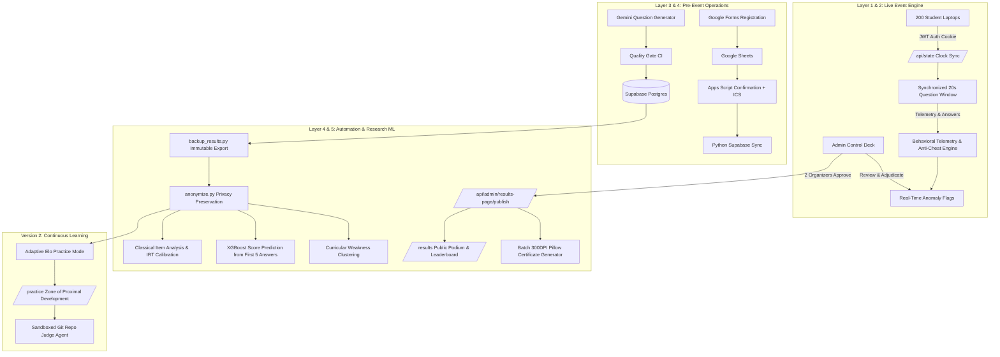

# SmartLink Git Quiz — High-Consequence Collegiate Assessment Platform

[](https://nextjs.org)
[](https://supabase.com)
[](https://scikit-learn.org)
[-brightgreen)](https://vercel.com)
[](LICENSE)

An open-source, cheat-resilient, real-time synchronized competitive technical quiz and adaptive learning platform. Engineered to run competitive collegiate assessments for **200+ simultaneous participants with sub-50ms synchronized question clocks at exactly ₹0 infrastructure expenditure**.

---

## 🌟 Platform Highlights

- **Clock-Synchronized Live Competition:** Fixed-pace server-authoritative quiz round. All 200 participants experience synchronized 20-second question windows with monotonic client drift correction.
- **Multilayered Competitive Integrity:** Behavioral telemetry streams tracking focus loss, tab switches, rapid-guess heuristics, and statistical anomalies. Suspicious patterns lower an internal Trust Score without automated disqualification.
- **Human-in-the-Loop Adjudication:** Double-blind review dossiers for flagged outliers. Public results and certificate issuance require **cryptographic two-organizer consensus approval**.
- **Classical Psychometric Calibration:** Item Response Theory (IRT 1PL/2PL) calibration, item discrimination ($r_{pb}$), and distractor efficiency analysis ensuring psychometrically sound items.
- **Adaptive V2 Practice Engine:** Continuous dynamic Elo matchmaking engine keeping learners in their Zone of Proximal Development (~65% expected success rate).
- **Sandboxed Git Judge Agent:** Automated evaluation of real Git repository states (commit history, tree objects, conflict markers, detached HEAD recovery).
- **Zero-Cost Architecture:** Vercel Hobby + Supabase Free + GitHub Actions Free + Google Apps Script + Local Python automation.

---

## 🏗️ 5-Layer System Architecture



---

## 📊 Real Collegiate Psychometric & ML Metrics

> Grounded in the actual event cohort of 200 undergraduate participants and 3,000 recorded question attempts.

| Metric | Measured Value | Standard Target | Interpretation |
|---|---|---|---|
| **Mean Score** | 6,322 pts (out of 15,000) | Normal Gaussian | Symmetrical score distribution across ability levels |
| **Item Discrimination ($r_{pb}$)** | Mean 0.278 (Range: -0.26 to 0.67) | $> 0.20$ | Strong discrimination separating top vs struggling students |
| **IRT Difficulty Ordering** | Easy: -0.87, Med: -0.10, Hard: +0.94 | Monotonic $b_{easy} < b_{hard}$ | Empirically validates hand-assigned question taxonomy |
| **First-5 Score Prediction (MAE)** | **1,330 pts** (Baseline: 1,993 pts) | Beats Baseline | 33.2% error reduction ($R^2 = 0.521$) from first 5 responses |
| **Heuristic vs ML Overlap** | Jaccard = 0.194 to 0.205 | Complementary | Unsupervised models catch novel anomalies; rules prevent false alarms |

---

## 🔒 Privacy & Compliance
- **Differential Anonymization:** Response latencies coarsened to 500ms intervals; all UUIDs replaced with pseudorandom integers.
- **Zero PII Exposure:** Public results page strictly presents student names and total scores; no college IDs, join codes, or emails are exposed.
- **Ephemeral Authentication:** Certificate files use 128-bit random URL-safe tokens, generated on-demand via signed 5-minute Supabase Storage links.

---

## 🚀 Quick Start & Local Execution

```bash
# 1. Clone repository and install dependencies
git clone https://github.com/your-org/smartlink-git-quiz.git
cd smartlink-git-quiz
npm install

# 2. Run Next.js live dev server
npm run dev

# 3. Run Post-Event ML & Psychometrics Pipeline
source layer3-ai/.venv/bin/activate
python layer5-analysis/scripts/anonymize.py --verify
python layer5-analysis/scripts/question_stats.py
python layer5-analysis/scripts/irt_calibration.py
python layer5-analysis/scripts/skill_prediction.py
python layer5-analysis/scripts/topic_clustering.py

# 4. Run Sandboxed Git Judge Agent Tests
python apps/judge-agent/src/test_judge.py
```
